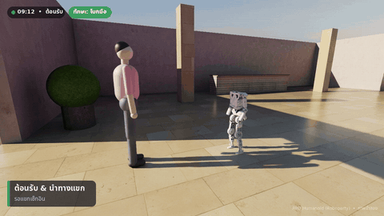
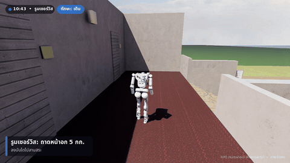
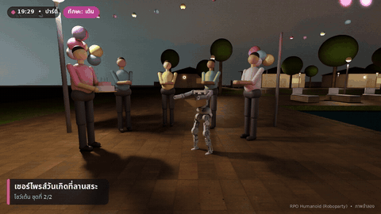
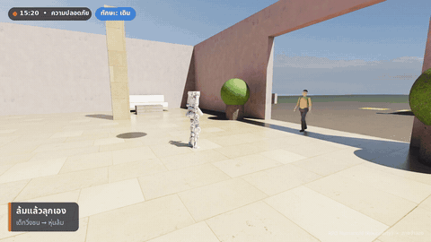
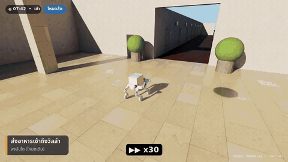
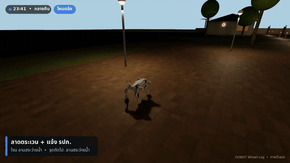
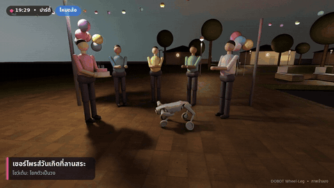

# Resort Robot Demos

เดโม่หุ่นยนต์ทำงานในรีสอร์ตแบบจำลอง (Isaac Lab 3 + Newton, เรนเดอร์ด้วย OVRTX path tracer) สองตัวในฉากเดียวกัน

- **RPO Humanoid** (Roboparty roboto_origin): งานหน้าบ้าน คือต้อนรับและนำทางแขก, ส่งของบนถาดหน้าอก, โชว์ในปาร์ตี้ และลุกเองเมื่อล้ม
- **Dobot Wheel-Leg** (หุ่นสี่ขามีล้อ): ลาดตระเวนกลางคืน, ส่งของขึ้นลงบันได, กล้องถ่ายรูปแขก และปาร์ตี้วันเกิด

> ทุกอย่างเป็นภาพจำลอง ยังไม่ได้ทดสอบบนหุ่นจริง

## RPO Humanoid

| ต้อนรับ + นำทาง | ส่งของ 5 กก. |
|---|---|
|  |  |
| **ปาร์ตี้: เต้นโชว์** | **ล้มแล้วลุกเอง** |
|  |  |

วิดีโอนำเสนอ 3:56 นาที (บีบแล้ว 18 MB): [media/RPO_resort_pitch_small.mp4](media/RPO_resort_pitch_small.mp4) · ไฟล์เต็มและคลิปผลรันแต่ละงานอยู่ใน [Releases](../../releases)

| งาน | ผลในแบบจำลอง |
|---|---|
| ต้อนรับ + นำทาง | โบกมือทักไทย/อังกฤษ เดินนำแขก 39 ม. ไปห้อง 306 ไม่ล้ม |
| ส่งของ | ถาดหน้าอก 5 กก. ลงบันได ถึงวิลล่า V2: 113 ม. ใน 3.9 นาที |
| ปาร์ตี้ | ถือเค้ก เปิดเพลง เต้น 2 ชุด เอียงสูงสุด ~10° ไม่ล้ม |
| ล้มแล้วลุก | ถูกชน 600 N 0.2 วิ ล้มหงาย ยืนได้อีกครั้งใน 6.7 วิ |

ข้อจำกัด: ไม่มีมือ (แขกหยิบของจากถาดเอง) · ล้มคว่ำหน้ายังลุกไม่ได้ใน Newton · แรงชนเป็นค่าที่ตั้งเอง · น้ำหนักบรรทุกจำลองเป็นมวลที่ลำตัว · ยังไม่รู้อายุแบต · ท่าเต้นไม่ตรงจังหวะเพลง

## Dobot Wheel-Leg

| ส่งของขึ้นลงบันได | ลาดตระเวนกลางคืน | ปาร์ตี้วันเกิด |
|---|---|---|
|  |  |  |

ลาดตระเวน 50 รอบแบบสุ่ม (พื้นเปียก, แรงผลัก, เก้าอี้ขวาง) สำเร็จ 50/50 ไม่ล้ม · 1 รอบ 233 ม. ≈ 5.6 นาที · ส่งของ 3 กก. 111 ม. ใน 2.9 นาที

## โครงสร้าง

| โฟลเดอร์ | |
|---|---|
| `rpo/` | โค้ด RPO (เดิม `~/rpo_tools/resort`) ดูรายละเอียดใน [rpo/README.md](rpo/README.md) |
| `dobot/` | โค้ด Dobot (เดิม `~/dobot_tools/resort`) ฉาก, คน, HUD, งานต่าง ๆ, สคริปต์ `run_stage_*.sh` |
| `isaaclab_overlay/` | ไฟล์ที่เพิ่มเข้าไปใน `~/IsaacLab`: asset หุ่น Dobot (จาก [dobot_quad_sdk](https://github.com/Dobot-Team/dobot_quad_sdk), MIT), task `dobot_quad` และ checkpoint ที่สคริปต์ใช้ |
| `media/` | GIF และวิดีโอนำเสนอที่บีบแล้ว |

## ติดตั้ง

ต้องมี Isaac Lab 3 (Newton) ที่ `~/IsaacLab` และ `uv` โค้ดอ้าง path แบบตายตัว จึงต้องลิงก์ให้อยู่ที่เดิม:

```bash
git clone git@github.com:pannatron/resort-robot-demos.git ~/repos/resort-robot-demos
cd ~/repos/resort-robot-demos
mkdir -p ~/rpo_tools ~/dobot_tools
ln -s $PWD/rpo   ~/rpo_tools/resort
ln -s $PWD/dobot ~/dobot_tools/resort

# ไฟล์ Dobot ใน Isaac Lab + checkpoint
rsync -a --exclude='*.patch' isaaclab_overlay/ ~/IsaacLab/
git -C ~/IsaacLab apply $PWD/isaaclab_overlay/dobot_assets_init.patch
```

RPO ต้องใช้โปรเจกต์ `rpo_lab` และ `roboto_origin` จากคอร์ส Simulation for Humanoid (Extra_RPO_Walk) ที่ `~/w7work/rpo_lab` และ `~/Downloads/Simulation_for_Humanoid/Extra_RPO_Walk/roboto_origin`

## รัน

```bash
cd ~/IsaacLab
# RPO: ทั้ง 4 งานแบบ RTX แล้วตัดวิดีโอนำเสนอ
~/rpo_tools/resort/run_rtx.sh
uv run --extra video python ~/rpo_tools/resort/rpo_pitch.py ~/rpo_tools/resort/results_rtx ~/rpo_tools/resort/clips/RPO_resort_pitch.mp4

# Dobot: ดูคำสั่งในสคริปต์ run_stage_rtx.sh / run_stage_payload.sh
~/dobot_tools/resort/run_stage_rtx.sh
```

ทดสอบบน RTX 3060 Laptop 6 GB, Ubuntu, ต.ค. 2026
